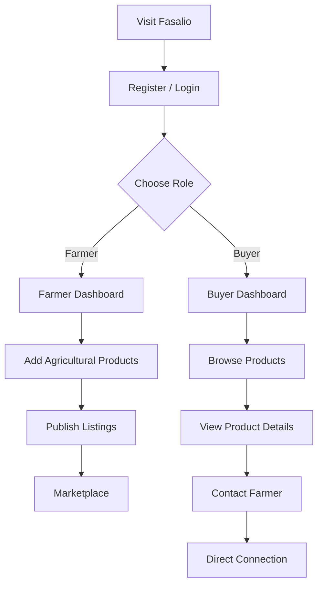

# 🌾 Fasalio — Farmer-to-Buyer Marketplace

**Empowering Farmers. Connecting Markets. Growing Together.**

Fasalio is a digital agricultural marketplace that connects farmers directly with buyers, helping eliminate unnecessary intermediaries and making agricultural trading more transparent, accessible, and efficient.

The platform enables farmers to showcase their agricultural products, manage product listings, and reach potential buyers while allowing buyers to discover fresh agricultural products directly from their sources.

Our vision is to empower farmers with better market opportunities and create a smarter agricultural ecosystem through technology.

---

## 📌 Table of Contents

- [About Fasalio](#-about-fasalio)
- [Problem Statement](#-problem-statement)
- [Our Solution](#-our-solution)
- [Key Features](#-key-features)
- [User Roles](#-user-roles)
- [How It Works](#-how-it-works)
- [Technology Stack](#-technology-stack)
- [Project Structure](#-project-structure)
- [Getting Started](#-getting-started)
- [Environment Variables](#-environment-variables)
- [Future Enhancements](#-future-enhancements)
- [Project Information](#-project-information)
- [License](#-license)

---

## 🌱 About Fasalio

Traditional agricultural markets often involve multiple intermediaries between farmers and buyers. This can reduce farmers' profit margins and make it difficult for them to access larger markets.

Fasalio aims to simplify this process by providing a centralized digital marketplace where farmers and buyers can interact directly.

With Fasalio:

- Farmers can list and showcase their agricultural products.
- Buyers can explore products from different farmers.
- Product prices and availability can be viewed easily.
- Buyers can connect directly with farmers.
- Agricultural trading becomes more transparent and convenient.

**Fasalio — From Farms to People.**

## 🚨 Problem Statement

The traditional agricultural supply chain faces several challenges:

- **Middlemen Dependency:** Farmers often depend on intermediaries to sell their products.
- **Low Profit Margins:** Multiple intermediaries can reduce farmers' earnings.
- **Limited Market Access:** Farmers struggle to reach buyers beyond their local markets.
- **Price Transparency:** Buyers and farmers may lack clear pricing information.
- **Communication Gap:** Direct communication between farmers and buyers is often difficult.
- **Product Discovery:** Buyers struggle to find farmers offering specific agricultural products.

## 💡 Our Solution

Fasalio provides a digital marketplace that simplifies agricultural trading through direct farmer-to-buyer connections.

Our platform focuses on:

1. Direct connections between farmers and buyers.
2. Easy agricultural product listing and discovery.
3. Transparent product pricing and availability.
4. Location-based product discovery.
5. Convenient communication between farmers and buyers.
6. A simple and accessible user experience.

## ✨ Key Features

### 👨‍🌾 Farmer Features

- Farmer registration and login.
- Create and manage product listings.
- Upload agricultural product images.
- Set product prices and quantities.
- Manage product availability.
- Receive buyer inquiries.
- Manage listed products.

### 🛒 Buyer Features

- Browse agricultural products.
- Search products by name and category.
- Filter products by price and location.
- View product and farmer details.
- Contact farmers directly.
- Send purchase inquiries.
- Discover available agricultural products.

### ⚙️ Platform Features

- Authentication and authorization.
- Role-based dashboards.
- Product management.
- Search and filtering.
- Responsive user interface.
- Secure data management.

## 👥 User Roles

| Role   | Responsibilities                                   |
| ------ | -------------------------------------------------- |
| Farmer | List products, manage inventory, receive inquiries |
| Buyer  | Discover products, explore prices, contact farmers |
| Admin  | Manage users and monitor platform activity         |

## 🔄 How It Works



## 🛠️ Technology Stack

The technology stack will be updated according to the final implementation.

| Category        | Technology           |
| --------------- | -------------------- |
| Frontend        | React.js             |
| Styling         | Tailwind CSS         |
| Backend         | Node.js              |
| API Framework   | Express.js           |
| Database        | PostgreSQL / MongoDB |
| Authentication  | JWT                  |
| Version Control | Git & GitHub         |
| Deployment      | Vercel / Render      |

## 📁 Project Structure

```text
Fasalio/
│
├── frontend/
│   ├── public/
│   ├── src/
│   │   ├── assets/
│   │   ├── components/
│   │   ├── pages/
│   │   ├── layouts/
│   │   ├── context/
│   │   ├── hooks/
│   │   ├── services/
│   │   ├── utils/
│   │   ├── App.jsx
│   │   └── main.jsx
│   └── package.json
│
├── backend/
│   ├── controllers/
│   ├── routes/
│   ├── middleware/
│   ├── models/
│   ├── config/
│   ├── utils/
│   ├── server.js
│   └── package.json
│
├── docs/
├── .gitignore
└── README.md
```

## 🚀 Getting Started

### Prerequisites

- Node.js (v18 or above)
- npm
- Git
- PostgreSQL or MongoDB (depending on implementation)

### 1. Clone the Repository

```bash
git clone <YOUR_GITHUB_REPOSITORY_URL>
```

### 2. Navigate to the Project

```bash
cd Fasalio
```

### 3. Install Frontend Dependencies

```bash
cd frontend
npm install
```

### 4. Install Backend Dependencies

```bash
cd ../backend
npm install
```

### 5. Configure Environment Variables

Create the required `.env` files in the frontend and backend directories.

### 6. Start the Backend

```bash
cd backend
npm run dev
```

### 7. Start the Frontend

Open another terminal:

```bash
cd frontend
npm run dev
```

Open the local development URL displayed in your terminal.

## 🔐 Environment Variables

Example backend `.env`:

```env
PORT=5000
DATABASE_URL=your_database_url
JWT_SECRET=your_secret_key
```

Example frontend `.env`:

```env
VITE_API_URL=http://localhost:5000/api
```

**Note:** Never push actual environment variables or secret credentials to GitHub.

## 🔮 Future Enhancements

- [ ] Online payment integration.
- [ ] Real-time farmer-buyer chat.
- [ ] Order management and tracking.
- [ ] AI-powered product recommendations.
- [ ] Agricultural market price information.
- [ ] Weather and crop information integration.
- [ ] Multilingual support for Indian regional languages.
- [ ] Verified farmer profiles.
- [ ] Buyer reviews and ratings.
- [ ] Mobile application for farmers.

## 👨‍💻 Project Information

| Detail       | Information                 |
| ------------ | --------------------------- |
| Project Name | Fasalio                     |
| Project Type | Solo Project                |
| Domain       | Agriculture / E-commerce    |
| Category     | Farmer-to-Buyer Marketplace |
| Development  | Independently Developed     |
| Status       | In Development              |

## 📄 License

This project is currently developed for educational and innovation purposes.

A suitable open-source license can be added when the project is ready for public distribution.

---

## 🌾 Our Vision

We believe technology can transform agriculture by making markets more accessible and opportunities more transparent.

Fasalio aims to bridge the gap between farmers and buyers, empower agricultural communities, and contribute towards a smarter agricultural future.

**Fasalio — Empowering Farmers. Connecting Markets. Growing Together.**
